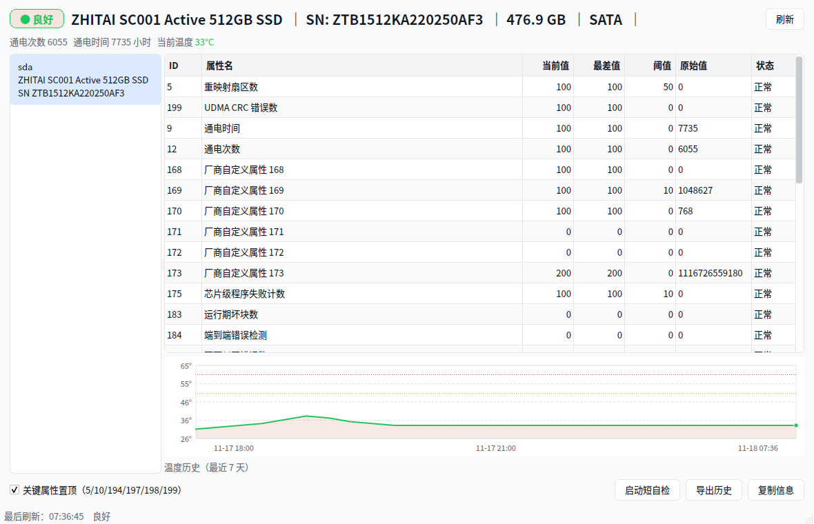

# KnowDiskDrive

Linux 磁盘健康检测工具。读取 smartctl 的 SMART 数据，用图形界面显示健康状态、温度曲线与属性表，同时提供命令行。



## 下载

见 [Releases](https://github.com/BeerenBoheme/KnowDiskDrive/releases)：

| 文件 | 说明 |
|---|---|
| ``knowdiskdrive-0.0.2-x86_64.AppImage`` | 单文件，双击运行，不需要装 Python |
| ``knowdiskdrive-0.0.2-py3-none-any.whl`` | pip 安装，需要 Python ≥ 3.10 |
| ``knowdiskdrive-0.0.2-src.tar.gz`` | 源码包 |

## 运行

前提：目标机装了 ``smartmontools``。

AppImage：

```bash
chmod +x knowdiskdrive-0.0.2-x86_64.AppImage
./knowdiskdrive-0.0.2-x86_64.AppImage
```

首次运行会提示权限不足，点界面上的「一键授权」并输入管理员密码即可；命令行等价写法：

```bash
knowdiskdrive fix-permission
```

pip：

```bash
pip install knowdiskdrive-0.0.2-py3-none-any.whl
knowdiskdrive-gui
```

## 命令行

``list`` / ``show`` / ``health`` / ``daemon`` / ``export`` / ``fix-permission``，数据类命令支持 ``--json``。

## 说明

- 仅 Linux x86_64，需要 glibc ≥ 2.35（Ubuntu 22.04+ / Debian 12+ / RHEL 9+）。
- **本项目由 AI 开发、AI 测试、AI 上传，不保证稳定性，使用自负风险。**
- Python 3.10 / 3.11 上 PySide6 必须低于 6.12（``pyproject.toml`` 已限定），否则退出时会崩溃。
- 开发与实现细节见 [docs/DEVELOPMENT.md](docs/DEVELOPMENT.md)。

## 许可

MIT
